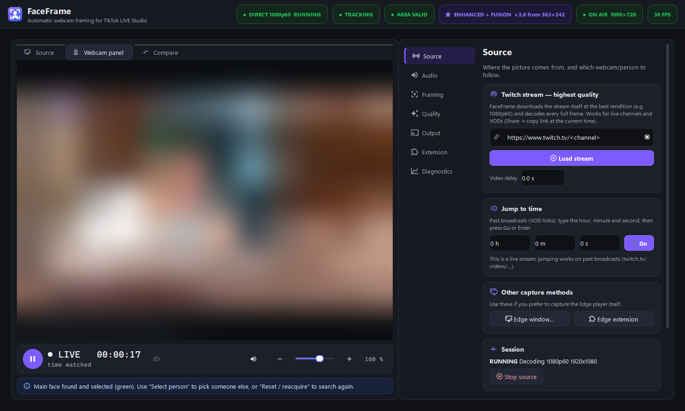
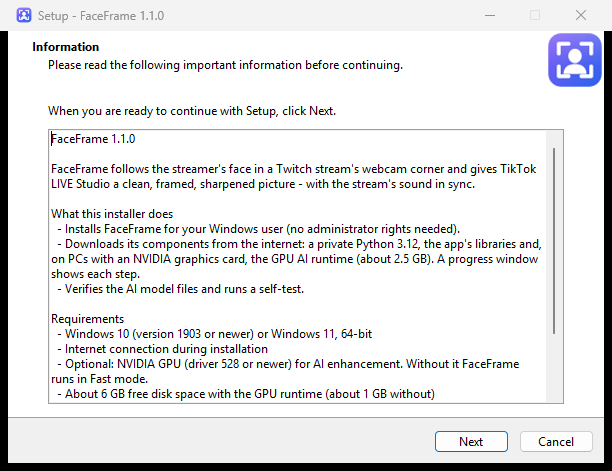
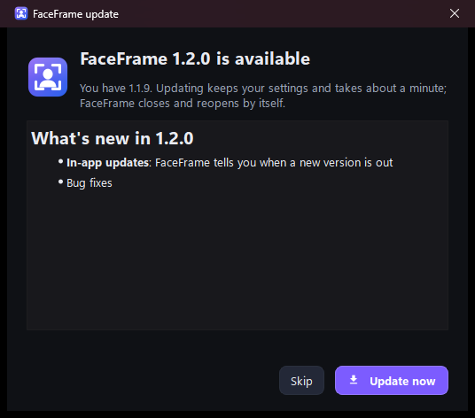
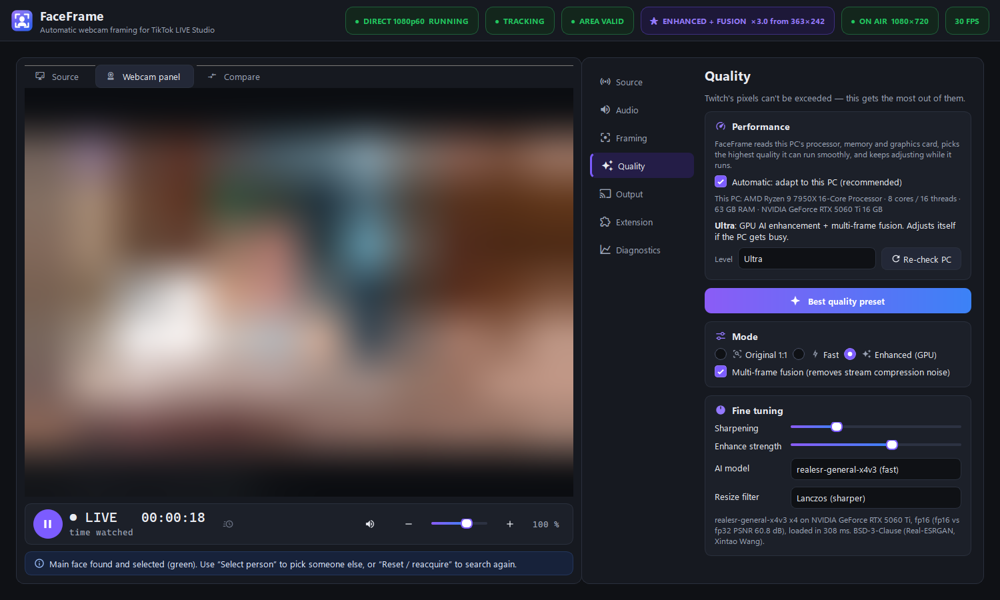
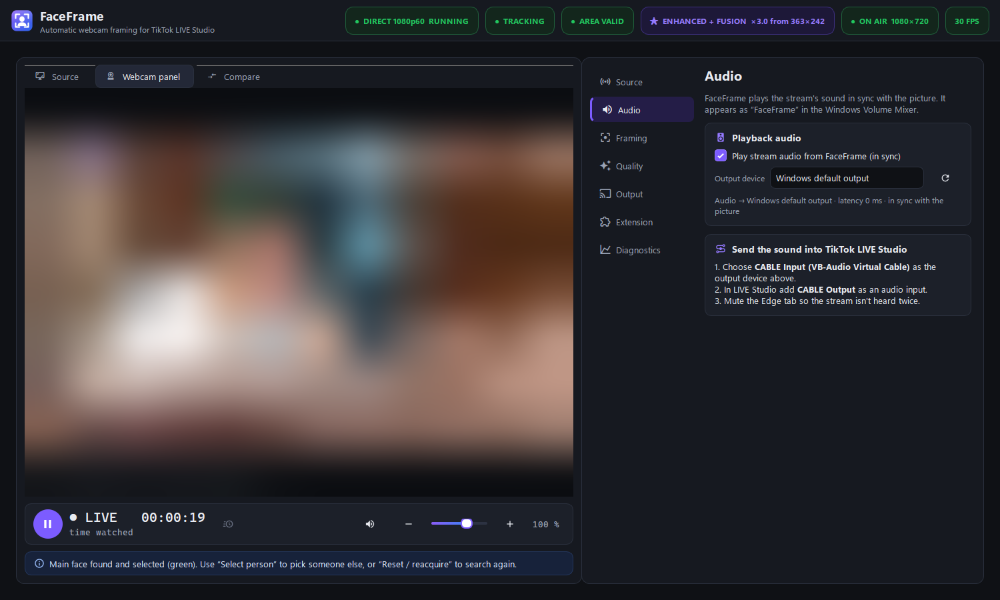
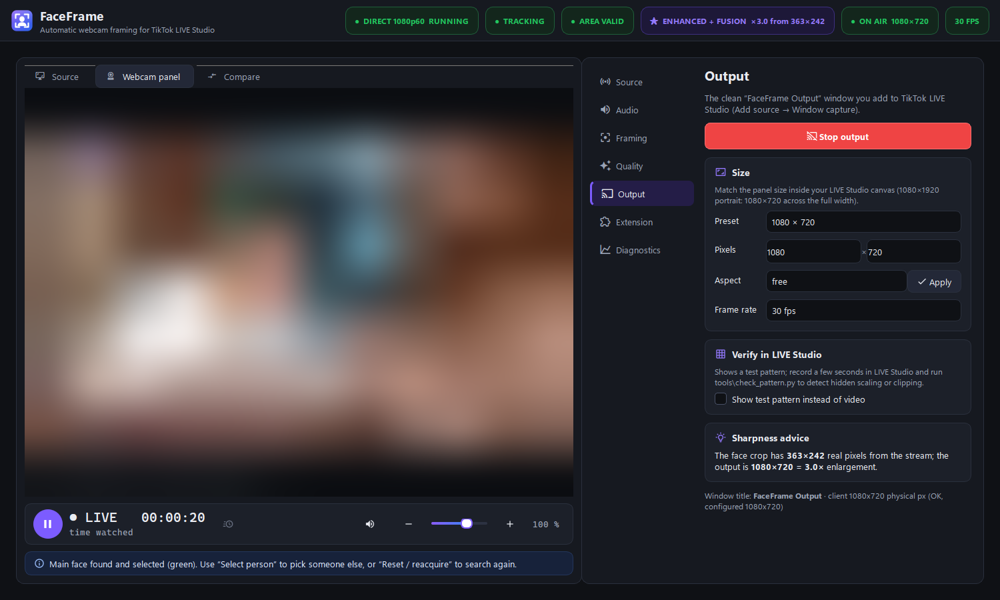
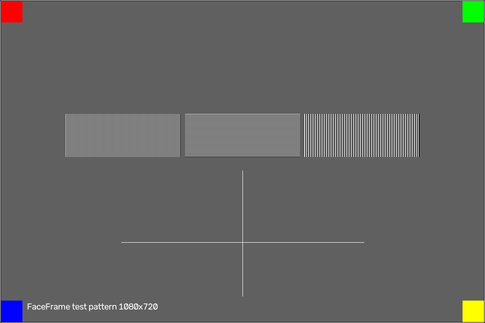

<p align="center">
  
</p>

<h1 align="center">FaceFrame</h1>

<p align="center">
  <b>The streamer's face, framed and sharp, for TikTok LIVE Studio.</b><br>
  Paste a Twitch link → FaceFrame decodes the full 1080p60 stream, follows the face in the webcam corner,
  cleans and sharpens it on your GPU, and gives LIVE Studio a clean window with in-sync sound.
</p>

<p align="center">
  <a href="https://github.com/Roy-Mutwiri/Twitch-Face-Card/releases/latest/download/FaceFrame-Setup.exe">
    
  </a>
</p>

<p align="center">
  <a href="https://github.com/Roy-Mutwiri/Twitch-Face-Card/releases/latest"></a>
  
  
  <a href="https://roy-mutwiri.github.io/Twitch-Face-Card/"></a>
</p>

<p align="center">
  
  <br><sub>Stream content is blurred in all screenshots. In the app you see the real picture.</sub>
</p>

---

## Features

| | |
|---|---|
| 📡 **Full-quality Twitch decode** | Paste a channel or past-broadcast link. FaceFrame plays Twitch's best rendition (1080p60) itself, so quality doesn't depend on the browser player size. Low latency, ads skipped, automatic reconnect. |
| 🎯 **Automatic face framing** | Finds the streamer in the webcam corner and follows them smoothly with head-and-shoulders framing. It never jumps to posters or other faces. |
| ✨ **GPU AI enhancement** | **Best quality** combines multi-frame fusion (removes stream compression noise without smearing motion) with Real-ESRGAN upscaling on NVIDIA GPUs (FP16, about 12 ms per frame). |
| 🔊 **Sound in sync** | Plays the stream's audio lip-synced to the picture. It appears as **FaceFrame** in the Windows Volume Mixer and can go to any output device (for example VB-Cable for LIVE Studio). |
| ⏯️ **Player bar** | Pause/resume, volume, mute, position / length / remaining time for past broadcasts, and time watched for live streams. |
| 🪟 **Clean output** | A pixel-exact **FaceFrame Output** window for LIVE Studio's *Window capture*, with no buttons or borders, plus a test pattern that proves LIVE Studio isn't rescaling it. |
| ⚙️ **Runs on any PC** | Reads your PC's processor, memory and graphics card, picks the best quality it can run smoothly, and keeps adjusting while it runs, so small PCs don't lag. |
| ⏩ **Jump to time** | For past broadcasts: type hours, minutes and seconds and press Go. |
| 🛡️ **Safe by design** | Doesn't touch Edge, Twitch, LIVE Studio, cookies or system codecs. Everything runs on your PC. |

## Install

1. **[Download FaceFrame-Setup.exe](https://github.com/Roy-Mutwiri/Twitch-Face-Card/releases/latest/download/FaceFrame-Setup.exe)** (about 100 MB).
2. Run it. If SmartScreen shows *"Windows protected your PC"*, choose **More info → Run anyway**. The installer isn't code-signed.
3. The installer sets everything up automatically:
   - a private Python runtime and all libraries (nothing is installed system-wide, and no admin rights are needed),
   - **on NVIDIA PCs:** the matching GPU AI runtime, chosen from your driver version (about 2.5 GB download),
   - the AI models (checksum-verified),
   - a self-test.
4. Start **FaceFrame** from the Start menu or the desktop.

<p align="center"></p>

| Your PC | What you get |
|---|---|
| NVIDIA GPU with driver 528 or newer (RTX 50 series: driver 570+) | Everything, including **Enhanced / Best quality** |
| No NVIDIA GPU, or an older driver | Everything except AI upscaling. **Fast** mode still uses the full stream quality. |

### Updates

FaceFrame checks for a new version every time it starts. When one is out you get a pop-up:

- **Update now:** downloads and verifies the new installer, then FaceFrame closes, updates itself (settings kept)
  and reopens. It takes about 40 s.
- **Skip:** nothing changes, and FaceFrame asks again the next time you open it.

You never need to download the app again. *(If you have 1.1.0, install the latest version once from the link
above. From then on, updates come through the app.)*

<p align="center"></p>

## Quick start (2 minutes)

1. **Source** page → paste `https://www.twitch.tv/<channel>` (or a `…/videos/…?t=1h2m3s` link) → **Enter** → quality **best**.
2. Drag a box **around the webcam corner** in the preview. The face is picked automatically.
3. **Quality → ★ Best quality preset**.
4. **Output → Use 1080 × 720 → Start output**.
5. **TikTok LIVE Studio → Add source → Window capture → FaceFrame Output** (100 % size, cursor off, locked).
6. *Sound in LIVE Studio:* Audio page → **CABLE Input**; in LIVE Studio add **CABLE Output** ([VB-Audio Virtual Cable](https://vb-audio.com/Cable/), free).

Full guide: **[docs/USER_GUIDE.md](docs/USER_GUIDE.md)**

## Screenshots

| Quality | Audio |
|---|---|
|  |  |
| **Output** | **Output window (what LIVE Studio captures)** |
|  |  |

## Quality: what to expect

FaceFrame shows the real numbers in its header, for example *ENHANCED + FUSION ×3.3 from 327×218*: the face crop
has 327×218 real stream pixels, enlarged 3.3×. Upscaling makes that crisp and clean, but it **can't invent
detail the stream never carried**. That's why we don't claim "4K" or "lossless".

Measured on the live channel `stylishnoob4` (1080p60, RTX 5060 Ti); see **[docs/TESTING.md](docs/TESTING.md)**:

- Best quality: about 30 fps output, AI upscale about 12 ms per frame, 95th-percentile latency under 70 ms, 0 rebuffers.
- Live and past broadcasts give the same quality (both 1080p60 at about 9 Mbit/s).

## Documentation

| | |
|---|---|
| [User guide](docs/USER_GUIDE.md) | install, first session, sound, best picture, controls |
| [Troubleshooting](docs/TROUBLESHOOTING.md) | symptoms and fixes, log locations |
| [Testing & QA report](docs/TESTING.md) | what was tested, how, and the measured results |
| [Architecture](docs/ARCHITECTURE.md) | how it works inside |
| [Changelog](CHANGELOG.md) · [Third-party notices](THIRD_PARTY_NOTICES.md) | |

## FAQ

**Is it free / does it need an account?** Yes, it's free. It needs no account and doesn't sign in to Twitch or TikTok.

**Does it work without an NVIDIA card?** Yes. You get Fast mode at full stream quality, without AI upscaling.

**Why is my picture soft?** The streamer's webcam corner is small. Use Best quality, a 1080×720 output and
*Head and shoulders* framing. See [Troubleshooting](docs/TROUBLESHOOTING.md).

**Does it go live or change my TikTok settings?** No. It only provides a window that you add yourself.

## Building from source

```powershell
git clone https://github.com/Roy-Mutwiri/Twitch-Face-Card.git
cd Twitch-Face-Card
powershell -ExecutionPolicy Bypass -File setup.ps1     # uv venv + locked packages + CUDA PyTorch + models
.venv\Scripts\python -m faceframe                      # run
.venv\Scripts\python -m pytest -q                      # 105 tests
powershell -ExecutionPolicy Bypass -File installer\build_installer.ps1   # → dist\FaceFrame-Setup-<ver>.exe
```

Building the installer needs [Inno Setup 6](https://jrsoftware.org/isinfo.php) and `uv`.

### Publishing an update

```powershell
powershell -ExecutionPolicy Bypass -File installer
elease.ps1 -Version 1.2.1 -Notes "What changed"
```

This sets the version, runs the tests, builds the installer, pushes and creates the GitHub release with
`FaceFrame-Setup.exe` and `SHA256SUMS.txt`. Every installed FaceFrame then shows the update pop-up at its next start.

---

<sub>FaceFrame by Roy Mutwiri. Not affiliated with Twitch, TikTok or Microsoft. Stream content belongs to its creators and is processed only on your PC.</sub>
